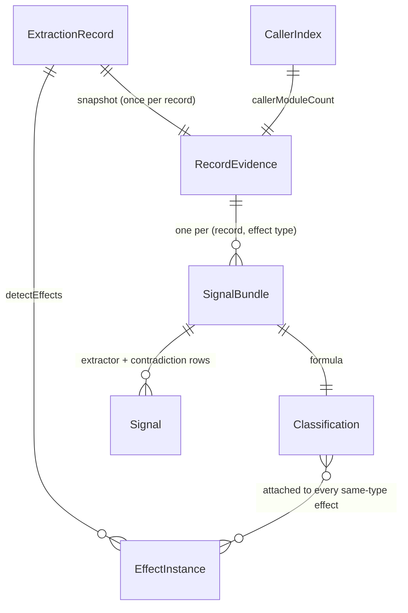

# Data Model: Classification Signal Pipeline (classify_signals)

**Feature Branch**: `003-classify-signals`

**Date**: 2026-10-28

**Status**: Complete — normative for implementation. The 48-row routing
table in Section 6 is the authoritative TypeScript mapping of FR-007; a
conformance test parses this document and diffs it against the code
table (see [research.md](research.md) R2). The Gaze analyzer protocol
v1.2.0 wire types are normative for every serialized field below.

Sources consulted: Gaze analyzer protocol v1.2.0 (wire types, JSON-RPC
envelope, method/capability names), the feature spec (FR-001 through
FR-018, Assumptions 1–16, Clarifications Q1–Q3), the existing
codebase models this change builds on (`src/models.ts` — `Signal` is
new; `Classification` already exists with its fail-loud serializer;
`src/analysis.ts` — `AnalyzeResponse`/`serializeAnalyzeResponse`;
`src/extract.ts` — `ExtractionRecord`; `src/program.ts` —
`ProgramContext`; `src/server.ts` — the analysis handler shape), the
installed `typescript@7.0.2` unstable API declarations (the types in
Section 5 mirror verified shapes), the snake-eyes reference
implementation (signal record shape, fan-out, ordering), and Dewey
prior learnings (Gaze `mergeClassifications`/`ComputeScore` consumption;
wire ordering keys).

---

## 1. Overview

The pipeline introduces one new wire record (`Signal`), gives the
existing `Classification` record its first producer, and adds four
internal value types that keep the compiler interaction isolated from
the pure classification rules:

| Type | Kind | Location | Role |
|---|---|---|---|
| `Signal` | Wire | `src/signals/types.ts` | One raw classification signal on one (function, effect-type) pair |
| `Classification` | Wire (existing) | `src/models.ts` | `{label, confidence}` attached to every `analyze` effect |
| `RecordEvidence` | Internal | `src/signals/evidence.ts` | Per-record snapshot of extractor inputs |
| `CallerIndex` | Internal | `src/signals/caller-index.ts` | Record → distinct in-scope calling modules |
| `RoutingBranch` | Internal | `src/signals/routing.ts` | One row of the normative routing table |
| `SignalBundle` | Internal | `src/signals/adapter.ts` | Per-pair extractor signals + contradiction + formula inputs |

Everything the platform consumes is a pure function of the input tree:
extractors read `RecordEvidence` (never the live program), the adapter
fans out per pair, the formula is closed-form, and ordering is a
documented total order ([research.md](research.md) R15).

## 2. Wire record: `Signal`

Emitted by the `classify_signals` method and consumed by Gaze's
`mergeClassifications` → `ComputeScore` (which sums every signal matched
to the effect — see the sum-invariant in Section 8).

| Field | Type | Required | Validation |
|---|---|---|---|
| `function` | string | yes | Unqualified function record name (the `ExtractionRecord.name` of the pair's record) — never `name` |
| `package` | string | yes | `derivePackage(relPath)` for the record's file |
| `side_effect_type` | string | yes | Canonical taxonomy name (resolved through `resolveSideEffectType`; aliases never emitted) |
| `source` | string | yes | Member of the closed set `{"interface", "visibility", "caller_count", "naming_convention", "docstring", "contradiction"}` |
| `weight` | integer | yes | Signed integer from the closed weight set (Section 7) |
| `reasoning` | string | no | Non-empty when present; deterministic fixed template naming the matched rule and token |

Serializer: `serializeSignal(signal)` follows `models.ts` house style —
fail-loud on any validation failure (closed-source membership, canonical
type resolution, integer weight, non-empty reasoning). The
`classify_signals` result is `{"signals": Signal[]}`; `analyze` never
emits `Signal` values (classifications only — FR-012).

Determinism: signals are ordered by `(package, function,
side_effect_type, source)` using codepoint comparison. Pair keying
(Section 5) keeps the key duplicate-free, so the order is total with no
tie-break rule.

## 3. Wire record: `Classification` (existing, first producer)

Unchanged from `src/models.ts`: `{label, confidence}` with
`label ∈ {"contractual", "ambiguous", "incidental"}` and integer
`confidence ∈ [0, 100]`, validated fail-loud by
`serializeClassification`. Spec 003 is its first producer: the adapter
computes one classification per (function record, canonical effect
type) pair and attaches it to **every** effect of that type on the
record (Section 5). Effects never carry partial or absent
classifications in `analyze` responses (SC-004).

## 4. Formula and labels

For each pair:

```
confidence = clamp(0, 100, 50 + tierBoost(type) + Σ(extractorWeights) − (contradiction ? 20 : 0))
```

| Input | Value | Source |
|---|---|---|
| Base | 50 | Pinned |
| `tierBoost` | P0 → +25, P1 → +10, P2/P3/P4 → +0 | Read from `TIER_MAP` (taxonomy is the single tier authority) |
| `Σ(extractorWeights)` | Sum of the pair's extractor signals (interface, visibility, caller_count, naming_convention, docstring) | Adapter |
| Contradiction | −20, applied once, **not** part of Σ | Synthesized signal (Section 5) |
| Labels | `contractual` ≥ 80; `ambiguous` [50, 80); `incidental` < 50 | Pinned boundaries |

Label boundaries are inclusive at 80 (contractual) and exclusive at 50
(incidental below): 80 → contractual, 79 → ambiguous, 50 → ambiguous,
49 → incidental. `clamp` bounds the arithmetic to [0, 100].

## 5. Internal types

### 5.1 `RecordEvidence` (src/signals/evidence.ts)

Computed once per function record; the pure extractors' only input
besides the effect type. Fields mirror the verified TypeScript unstable
API shapes where they are lifted from the compiler:

| Field | Type | Mode | Contents |
|---|---|---|---|
| `record` | `ExtractionRecord` | both | name, relPath, line, node, scopeChain |
| `exportedFunction` | boolean | both | ESM `export` modifier (incl. `export default`) or CJS `module.exports`/`exports.X` form targets the binding (+8 component) |
| `exportedReturnType` | boolean | program | Explicit return type annotation contains a type reference resolving to an exported/ambient symbol (+6 component) |
| `exportedReceiver` | boolean | both | Enclosing class-like declaration is exported (same closed rule) (+6 component) |
| `docText` | string | both | Flattened JSDoc comment text (description + tag comment text) |
| `docTags` | `readonly {tag, text}[]` | both | JSDoc tags attached to the declaration (`getJSDocTags`) |
| `interfaceMember` | boolean | program | A declared member of an interface in the record's enclosing class heritage resolves with the record's name |
| `callerModuleCount` | number | program | Distinct in-scope modules with ≥1 qualifying call site (self-recursion excluded) |

### 5.2 `CallerIndex` (src/signals/caller-index.ts)

`Map<recordIdentity, number>` built by one
`checker.getSignatureUsage(recordNode)` query per record in program
mode; empty in parse-only mode. Per usage carrying a call expression:
map the call handle's `path` to a root-relative path, keep it only when
in the request's in-scope file set, exclude positions inside the
record's own body span. The defining module counts when other functions
in it call the record; multiple sites in one module count once
(US3-1..7).

### 5.3 `RoutingBranch` (src/signals/routing.ts)

One row of the table in Section 6:
`{naming: string[], docTags: string[], docIndirect: string[], docIncidental: string[]}`
— the agreeing contractual naming prefixes, direct JSDoc tags, indirect
prose verbs, and incidental prefixes+verbs for one canonical effect
type. The table is `Readonly<Record<SideEffectType, RoutingBranch>>` —
compile-time exhaustive over the 48 canonical types (the `TIER_MAP`
pattern), runtime-asserted against `SIDE_EFFECT_TYPES` and
doc-parity-checked by `tests/signals/routing.test.ts`.

### 5.4 `SignalBundle` (src/signals/adapter.ts)

Per (function record, canonical effect type) pair: the extractor
signals (at most one per extractor — five total), the synthesized
contradiction signal when polarities are mixed, and the formula inputs
(tier boost from `TIER_MAP`). The bundle is the unit that produces the
pair's `Classification` and its wire rows; every effect of the same
type on the record shares the bundle's outputs.

**Pair keying (normative)**: extractors run once per (record, canonical
effect type) — never per effect instance. Same-type effect instances on
a record receive identical signals and identical classifications. This
is forced by construction (extractor inputs are record-level or
type-level) and required by the FR-011 sum-invariant (Section 8).
`contradiction` fires iff the pair's extractor signals include ≥1
positive-weight and ≥1 negative-weight signal; realizable only where
negative evidence routes (the output family: `LogWrite`, `StdoutWrite`,
`StderrWrite`).

## 6. Normative routing table (48 rows)

Authoritative TypeScript mapping of FR-007. Column key — **Contractual
prefixes**: leading-name prefixes whose presence agrees with the effect
(+10 via `naming_convention`); **Incidental prefixes**: prefixes whose
presence disagrees (−10); **Direct tags**: JSDoc tags whose presence
agrees (+15 via `docstring`); **Indirect verbs**: prose verbs whose
presence agrees (+5); **Incidental verbs**: prose verbs whose presence
disagrees (−15). "—" means no vocabulary routes to this effect type for
that column. Vocabularies are drawn only from the FR-005/FR-006 closed
lists. The `Err` prefix + `SentinelError` special case (+30, in place of
the prefix rules) is not a table row — it is a naming-extractor rule
keyed on this table's `SentinelError` row.

| Effect type | Contractual prefixes | Incidental prefixes | Direct tags | Indirect verbs | Incidental verbs |
|---|---|---|---|---|---|
| ReturnValue | Get, Fetch, Load, Read, Compute, Analyze, Classify, Parse, Build, New | — | @returns | returns | — |
| GeneratorYield | Get, Fetch, Load, Read, Compute, Analyze, Classify, Parse, Build, New | — | @returns | returns | — |
| AsyncGeneratorYield | Get, Fetch, Load, Read, Compute, Analyze, Classify, Parse, Build, New | — | @returns | returns | — |
| ImportSideEffect | Load | — | — | — | — |
| ErrorReturn | — | — | @throws | — | — |
| ErrorSignal | — | — | @throws | — | — |
| SentinelError | Err special case only | — | @throws | — | — |
| ReceiverMutation | Update, Set, Delete, Remove | — | — | modifies, updates, sets, deletes, removes | — |
| PointerArgMutation | Update, Set, Delete, Remove | — | — | modifies, updates, sets, deletes, removes | — |
| SliceMutation | Update, Set, Delete, Remove | — | — | modifies, updates, sets, deletes, removes | — |
| MapMutation | Update, Set, Delete, Remove | — | — | modifies, updates, sets, deletes, removes | — |
| GlobalMutation | Update, Set, Delete, Remove | — | — | modifies, updates, sets, deletes, removes | — |
| ContainerMutation | Update, Set, Delete, Remove | — | — | modifies, updates, sets, deletes, removes | — |
| EnvVarMutation | Update, Set, Delete, Remove | — | — | modifies, updates, sets, deletes, removes | — |
| DeferredReturnMutation | Update, Set, Delete, Remove | — | — | modifies, updates, sets, deletes, removes | — |
| ClosureCaptureMutation | Update, Set, Delete, Remove | — | — | modifies, updates, sets, deletes, removes | — |
| MonkeyPatch | Update, Set, Delete, Remove | — | — | modifies, updates, sets, deletes, removes | — |
| MetaprogrammingMutation | Update, Set, Delete, Remove | — | — | modifies, updates, sets, deletes, removes | — |
| FileSystemMeta | Update, Set | — | — | modifies, updates | — |
| FileSystemWrite | Save, Write | — | — | writes, persists, stores | — |
| DatabaseWrite | Save, Write | — | — | writes, persists, stores | — |
| WriterOutput | Save, Write | — | — | writes | — |
| HTTPResponseWrite | Save, Write, Handle, Process | — | — | writes | — |
| StreamOutput | Save, Write | — | — | writes | — |
| StdoutWrite | Write | log, debug, trace, print | — | writes | logs, prints, traces, debugs |
| StderrWrite | Write | log, debug, trace, print | — | writes | logs, prints, traces, debugs |
| LogWrite | Write | log, debug, trace, print | — | writes | logs, prints, traces, debugs |
| FileSystemDelete | Delete, Remove | — | — | deletes, removes | — |
| AtomicOp | Update, Set | — | — | modifies, updates, sets | — |
| ChannelSend | Handle, Process | — | — | — | — |
| GoroutineSpawn | Build, New | — | — | — | — |
| DescriptorEffect | Build, New | — | — | — | — |
| FinalizerRegistration | Build, New | — | — | — | — |
| CgoCall | Build, New | — | — | — | — |
| ChannelClose | — | — | — | — | — |
| DatabaseTransaction | — | — | — | — | — |
| CallbackInvocation | — | — | — | — | — |
| ContextCancellation | — | — | — | — | — |
| ResourceManagement | — | — | — | — | — |
| TimeDependency | — | — | — | — | — |
| ProcessExit | — | — | — | — | — |
| Panic | — | — | — | — | — |
| MutexOp | — | — | — | — | — |
| WaitGroupOp | — | — | — | — | — |
| RecoverBehavior | — | — | — | — | — |
| ReflectionMutation | — | — | — | — | — |
| UnsafeMutation | — | — | — | — | — |
| SyncPoolOp | — | — | — | — | — |

The closed vocabularies (the union of everything the table may draw
from — FR-005/FR-006):

- **Contractual prefixes (18)**: Get, Fetch, Load, Read, Save, Write,
  Update, Set, Delete, Remove, Handle, Process, Compute, Analyze,
  Classify, Parse, Build, New
- **Incidental prefixes (4)**: log, debug, trace, print
- **Direct tags (2)**: @returns, @throws
- **Indirect verbs (9)**: returns, writes, modifies, updates, sets,
  persists, stores, deletes, removes
- **Incidental verbs (4)**: logs, prints, traces, debugs

## 7. Closed weight set

| Source | Weight | Rule |
|---|---|---|
| `interface` | +30 | Class-member declared in an interface of the enclosing class's heritage (program mode) |
| `visibility` | +8 / +6 / +6, clamp +20 | Exported function / exported return type (program) / exported receiver — components summed, clamped |
| `caller_count` | +5 / +10 / +15 | 1 / 2–3 / ≥4 distinct in-scope calling modules (program mode); 0 → no signal |
| `naming_convention` | +10 / −10 / +30 | Contractual prefix / incidental prefix (routed) / `Err`+`SentinelError` special case |
| `docstring` | +15 / +5 / −15 | Direct tag / indirect verb / incidental verb (routed; strongest tier only) |
| `contradiction` | −20 | Synthesized iff the pair's extractor signals mix positive and negative weights |

Every emitted `Signal.weight` comes from this set (serializer-checkable
integers). Visibility may emit intermediate clamped sums (e.g. +14, +20).

## 8. Key relationships and invariants



- **Sum-invariant (FR-011, normative)**: for every pair,
  `confidence = clamp(0, 100, 50 + tierBoost + Σ(all emitted signal
  weights for the pair))` — where the emitted set includes the
  contradiction row as a negative-weight entry. A consumer summing all
  signals Gaze matches to the effect reproduces the reported confidence
  exactly. Duplicate wire rows would break this; pair keying forbids
  them.
- **Consistency (FR-013)**: `analyze` classifications and
  `classify_signals` signals are computed by one shared pipeline over
  one shared `prepareAnalysis` file set; the labels are derivable from
  the emitted signals via the sum-invariant.
- **Totality**: every canonical effect type has exactly one routing row;
  the `Record` keying is compile-time exhaustive; the 48 rows above are
  the complete table.
- **Mode degradation (precision, never availability)**: parse-only
  analysis drops the `interface` and `caller_count` signals and the
  `exportedReturnType` visibility component; naming, docstring, the
  syntactic visibility components, and the formula remain. Classifications
  still attach to every effect (labels may shift toward `ambiguous`).

## 9. Verification checkpoints

- **SC-001**: controlled-signal-profile fixtures assert exact
  `{label, confidence}` arithmetic through the full pipeline
  (naming-only 85; incidental 25; contradiction 25; ambiguous floor 75;
  interface boundary 80; caller+visibility 93 — the quickstart tree).
- **SC-004**: every effect in every `analyze` fixture response carries a
  serializer-valid classification.
- **SC-005/SC-006**: golden byte-identical repeat responses for both
  methods; capability response shows `classify_signals: true` with the
  other five flags unchanged.
- **Routing conformance**: `tests/signals/routing.test.ts` asserts 48
  keys, closed-list vocabulary, and parity between this document's table
  and the code table.
- **FR-011 check**: tests assert the sum-invariant for every pair in the
  profile fixtures.
